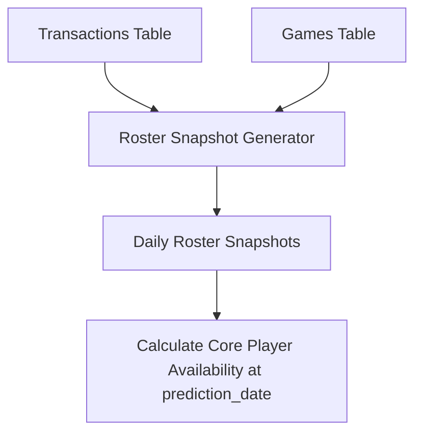

# Historical Season Ingestion and Reuse Plan

This document details the transition plan from the current single-season (2025-26) pipeline to a multi-season architecture supporting 5+ historical seasons.

---

## 1. Directly Reusable Components

The core mathematical and analytical features implemented for the 2025-26 season are robust, leakage-free, and season-agnostic. They can be reused directly:
*   **Rolling Aggregations:** Grouping by entity (`TEAM_ID` or `Player_ID`), sorting chronologically, applying `.shift(1).rolling(W).mean()` works correctly across seasons.
*   **Home/Away Split Logic:** The home/away masking and chronological forward-fill logic are season-agnostic.
*   **Franchise Head-to-Head (H2H):** Grouping on `["TEAM_ABBREVIATION", "OPPONENT_ABBREVIATION"]` and applying rolling functions shifted by 1 works across seasons.
*   **Self-Join Opponent Logic:** Merging team rows on `GAME_ID` is reusable.
*   **Inference Scripts & ML Service:** The FastAPI web service and prediction flows remain unchanged.

---

## 2. Code Refactoring Requirements

To support multiple historical seasons, the hardcoded season names and files must be refactored:

### Parameterizing File Paths
Refactor paths under `scripts/build_matchup_features.py`, `main.py`, and `prepare_score_model.py` to be dynamically parameterized by season:
```python
# Refactor from:
FEATURES_PATH = ROOT / "data/features/team_games_features_2025_26.parquet"

# To:
def get_features_path(season: str):
    return ROOT / f"data/features/team_games_features_{season}.parquet"
```

### Decoupling Ingestion CLI Commands
Add a `--season` parameter to `main.py` CLI interface:
```bash
python main.py --update-data --season 2024-25
python main.py --sync-pipeline --season 2024-25
python main.py --build-enhanced-v2 --season 2024-25
```

---

## 3. Roster snapshots & Trade Handling

Rosters are dynamic. Using a single static `core_players.csv` will fail for past seasons. We must transition to a dynamic transaction-based roster builder.



### Steps:
1.  **Ingest Transactions:** Create a `transactions` table containing player transfers, signings, waivers, and injuries with an `effective_date`.
2.  **Generate Roster Snapshots:** Implement `scripts/ingest/roster_snapshot_generator.py` to compile daily active rosters by applying transaction logs sequentially.
3.  **Compute expected minutes:** Expected player minutes and roles should be computed based on the previous season's stats or early-season games.
4.  **As-Of Joins:** When making predictions for a game on date `T`, join the team features with the latest roster snapshot where `snapshot_date < T`.

---

## 4. Cold-Start and Early-Season Rules

For the first 5–10 games of any historical season:
*   **Rolling Averages Fallback:** Rolling team averages (`PTS_LAST_10`) will have NaN values.
*   **Fallback Strategy:** Use the previous season's final rolling averages (decayed by 20% toward the league average) as the starting prior for the new season.
*   **Rookie/New Joiner priors:** For players entering the league or joining a new team, use a league-average default for expected minutes and decay toward their actual performance after 3 games.

---

## 5. Multi-Season Validation Split

*   **Chronological Season Folds:** Rather than a simple random train/test split, implement an expanding-window season-aware cross-validation:
    *   *Fold 1:* Train on 2021-22, Validate on 2022-23.
    *   *Fold 2:* Train on 2021-22 & 2022-23, Validate on 2023-24.
    *   *Fold 3:* Train on 2021-22, 2022-23, & 2023-24, Validate on 2024-25.
    *   *Holdout Set:* Keep the 2025-26 season as the final out-of-sample test set.
