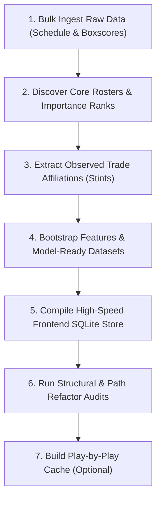

# NBA Season Onboarding & Bootstrapping Guide

This runbook documents the complete end-to-end command sequence required to ingest, process, audit, and bootstrap a new NBA season (e.g. `2025-26` or `2026-27`) into the production prediction pipeline and frontend application.

---

## The Complete Bootstrapping Workflow

To onboard a season from scratch, execute the following commands sequentially from the project root:



---

### Step 1: Bulk Ingest Raw Boxscores & Schedule
Fetches the season schedule, team logs, player logs, and traditional box scores from the official NBA API:
```bash
PYTHONPATH=. python3 main.py --season YYYY-YY --update-data
```
- **What it does**: Pulls all raw data via `LeagueGameLog` with randomized jitter and exponential backoff, storing raw outputs under `data/season=YYYY-YY/raw/`.

---

### Step 2: Discover Core Rosters & Player Importance Scores
Identifies franchise stars (`IS_TOP3_CORE`) and primary rotation players (`IS_TOP5_CORE`):
```bash
PYTHONPATH=. python3 main.py --season YYYY-YY --run-roster-analysis
```
- **What it does**: Generates roster tables, calculates player Importance Scores, and updates `data/production/core_players.csv`.
- **Output Report**: Emits a markdown audit under `reports/operations/season=YYYY-YY/roster_analysis.md`.

---

### Step 3: Extract Observed Trade Affiliations (Stints)
Reconstructs player-team affiliation timelines to eliminate trade leakage:
```bash
PYTHONPATH=. python3 scripts/ingest/build_observed_affiliation_events.py --season YYYY-YY
```
- **What it does**: Outputs transaction stint timelines to `data/experimental/observed_affiliation_events_YYYY_YY.csv`.

---

### Step 4: Bootstrap Features & Model-Ready Datasets
Calculates rolling metrics, creates V3 team datasets, and packages initial season context:
```bash
PYTHONPATH=. python3 main.py --season YYYY-YY --bootstrap-season
```
- **What it does**: 
  1. Generates 5/10/20-game rolling team and player features.
  2. Assembles `team_model_ready_v3_{YYYY_YY}.parquet` (and `.csv`) with Dean Oliver Four Factors and Continuous Elo ratings.
  3. Writes season manifests to `data/manifests/`.

---

### Step 5: Compile High-Speed Frontend SQLite Store
Compiles raw JSON files and game logs into an indexed, zero-overhead SQLite database:
```bash
PYTHONPATH=. python3 scripts/build_frontend_db.py
```
- **What it does**: Creates `data/frontend/nba_frontend.db` with WAL mode and B-tree indexes, enabling sub-millisecond (<1ms) point lookups for game details and historical logs.

---

### Step 6: Run Quality Control & Structural Audits
Verifies that all required files exist and paths conform to the season-scoped architecture:
```bash
PYTHONPATH=. python3 scripts/audit/validate_project_structure.py && PYTHONPATH=. python3 scripts/audit/validate_season_path_refactor.py
```
- **What it does**: Validates path resolutions, schema completeness, and production artifact integrity.

---

### Step 7: Build Play-by-Play Cache (Optional)
Generates enriched play-by-play timelines (quarter scores, running player totals, highlight badges):
```bash
# Preview games without API calls
PYTHONPATH=. python3 scripts/build_play_by_play.py --season YYYY-YY --dry-run

# Ingest and cache playoff / Finals games
PYTHONPATH=. python3 scripts/build_play_by_play.py --season YYYY-YY --season-type "NBA Finals"
```
- **What it does**: Writes source caches to `data/season=YYYY-YY/raw/play_by_play/{GAME_ID}.json` and exports copies to `frontend/public/data/play_by_play/`.

---

## Verifying Frontend Delivery

After completing the steps above:
1. Start the stack: `./scripts/start_all.sh`
2. Open the dashboard at `http://localhost:5173`.
3. Check the **Predictions** view:
   - Games should be paginated cleanly week-by-week using the new calendar dropdown navigator.
   - Network payloads should remain minimal (~25 KB per week).
