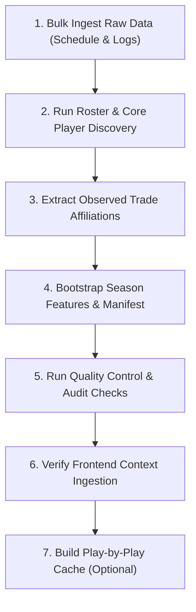

# NBA Season Onboarding & Bootstrapping Guide

This guide documents the exact step-by-step pipeline commands and operations required to ingest, bootstrap, validate, and export a new NBA season (e.g. `2024-25`) to both production models and the frontend application cache.

---

## The Core Bootstrapping Workflow

To ingest a new season from scratch, you must execute the following operations sequentially. Run all commands from the root directory of the workspace with the virtual environment activated.



### Step 1: Bulk Ingest Raw Boxscores & Schedule
Fetches the designated season's schedule, team logs, and player logs from the official NBA API.
```bash
PYTHONPATH=. python3 main.py --season YYYY-YY --update-data
```
- **What it does**: Pulls all raw data via `LeagueGameLog` and parallel threads, storing them in `data/season=YYYY-YY/raw/`.

### Step 2: Discover Core Rosters & Ranks
Computes player Importance Scores and automatically tags Star (`IS_TOP3_CORE`) and Rotation (`IS_TOP5_CORE`) players.
```bash
PYTHONPATH=. python3 main.py --season YYYY-YY --run-roster-analysis
```
- **What it does**: Generates rosters, player lookup mappings, and automatically synchronizes `core_players.csv` to `data/production/` and `data/canonical/`.
- **Output Reports**: Generates detailed markdown listings under `reports/operations/season=YYYY-YY/`.

### Step 3: Extract Observed Trade Affiliations (Stints)
Processes player logs chronologically to reconstruct transaction stint timelines.
```bash
PYTHONPATH=. python3 scripts/ingest/build_observed_affiliation_events.py --season YYYY-YY
```
- **What it does**: Outputs stint timeline parameters to `data/experimental/observed_affiliation_events_YYYY_YY.csv` to prevent future trade leakage.

### Step 4: Bootstrap Season Features & Manifest
Executes the central orchestrator task that compiles team features, rebuilds game results, creates V2/V3 datasets, and updates the manifests.
```bash
PYTHONPATH=. python3 main.py --season YYYY-YY --bootstrap-season
```
- **What it does**: 
  1. Computes rolling team and player features.
  2. Creates the final `team_model_ready_v2.csv` datasets.
  3. Writes the season signature properties to `data/manifests/`.
  4. Automatically exports frontend-ready JSON bundles (games, details, averages) directly to `frontend/public/data/`.

### Step 5: Run Quality Control & Audit Checks
Executes structural and mathematical audit checks to guarantee code pathways and directories match the production constraints.
```bash
PYTHONPATH=. python3 scripts/audit/validate_project_structure.py && PYTHONPATH=. python3 scripts/audit/validate_season_path_refactor.py
```
- **What it does**: Audits JSON hashes, pickle wrappers, dynamic path variables, and path resolver functions.

### Step 6: Build Frontend Play-by-Play Cache
The React game detail view can render a richer quarter-by-quarter play-by-play feed when cached files exist under `frontend/public/data/play_by_play/`.

Use the dedicated CLI after `--bootstrap-season` has exported `frontend/public/data/all_seasons_games.json`.

Preview selected games without calling the NBA API:
```bash
PYTHONPATH=. python3 scripts/build_play_by_play.py --season YYYY-YY --dry-run
```

Build all final games for a season:
```bash
PYTHONPATH=. python3 scripts/build_play_by_play.py --season YYYY-YY
```

Build only a specific season type, for example NBA Finals:
```bash
PYTHONPATH=. python3 scripts/build_play_by_play.py --season YYYY-YY --season-type "NBA Finals"
```

Build one or more explicit game IDs:
```bash
PYTHONPATH=. python3 scripts/build_play_by_play.py --game-id 0042500405
PYTHONPATH=. python3 scripts/build_play_by_play.py --game-id 0042500401 0042500402 0042500403
```

Overwrite existing cached files:
```bash
PYTHONPATH=. python3 scripts/build_play_by_play.py --game-id 0042500405 --force
```

Useful batch controls:
```bash
PYTHONPATH=. python3 scripts/build_play_by_play.py --season YYYY-YY --limit 10 --sleep 0.8
PYTHONPATH=. python3 scripts/build_play_by_play.py --season YYYY-YY --no-final-only
```

- **What it does**: Fetches NBA `PlayByPlayV3`, calculates quarter scores, derives event-level `points_scored`, maintains running player totals, extracts assist metadata, and writes JSON files to `frontend/public/data/play_by_play/{GAME_ID}.json`.
- **Summary output**: Also writes `frontend/public/data/schedule_details_YYYY_YY.json`, a small per-season map used by game cards for quarter scores, top scorers, event counts, and PBP availability.
- **Default source**: `frontend/public/data/all_seasons_games.json`.
- **Default behavior**: Existing cache files are skipped unless `--force` is provided.
- **Frontend behavior**: If a game has no cached PBP file, the UI shows a cache-missing message instead of failing.

Rebuild only the small summary file from existing PBP cache, without NBA API calls:
```bash
PYTHONPATH=. python3 scripts/build_play_by_play.py --season YYYY-YY --summary-only
```

---

## Frontend Integration & Data Flow

When Step 4 (`--bootstrap-season`) completes, it automatically invokes `scripts/export_frontend_data.py`. This script translates the machine-friendly CSV/Parquet outputs under `data/` into compressed JSON feeds for the React frontend client:

1. **Target Directory**: `frontend/public/data/` (or `frontend/src/assets/` depending on webpack alias setup).
2. **Key Feeds Generated**:
   - `games.json`: Contains completed and upcoming fixtures.
   - `game_details.json`: Box score aggregates and player performances.
   - `player_season_averages.json`: Current averages used for player projections.
   - `player_season_games.json`: Historical game logs representing player form.
   - `play_by_play/{GAME_ID}.json`: Optional per-game play-by-play cache generated by `scripts/build_play_by_play.py`.
   - `schedule_details_YYYY_YY.json`: Lightweight schedule summary generated from PBP cache; safe to load on game-list screens.
3. **Frontend Warm-Up**: During backend startup, the frontend cache is automatically warmed up using these files to ensure instant load times without querying the heavy Python ML service repeatedly.
