# NBA ML Project — Full Data Architecture Audit & Dataset Lineage Report

> Generated: 2026-06-06
> Overall Status: **WARNING** (Pipeline Sync Gap & Raw Data Mismatches Detected)

---

## Part 1 — Dataset Inventory

### Raw Datasets

#### 1. Raw Team Game Logs
* **File Path**: [nba_team_games_2025_26_regular_and_playoffs.csv](file:///Users/serhat/agProjects/nbaModelApp/data/raw/team_games/nba_team_games_2025_26_regular_and_playoffs.csv)
* **Shape**: `(2634, 29)`
* **Column Count**: 29
* **Full Column List**: `['SEASON_ID', 'TEAM_ID', 'TEAM_ABBREVIATION', 'TEAM_NAME', 'GAME_ID', 'GAME_DATE', 'MATCHUP', 'WL', 'MIN', 'PTS', 'FGM', 'FGA', 'FG_PCT', 'FG3M', 'FG3A', 'FG3_PCT', 'FTM', 'FTA', 'FT_PCT', 'OREB', 'DREB', 'REB', 'AST', 'STL', 'BLK', 'TOV', 'PF', 'PLUS_MINUS', 'SEASON_TYPE']`
* **Source & Origin**: NBA API (`leaguegamelog` endpoint).
* **Generation Method**: Downloaded from an external Colab notebook scraper.
* **Role**: Primary ground-truth log for all completed team games.

#### 2. Raw Player Game Logs
* **File Path**: [nba_player_games_2025_26_regular_and_playoffs.csv](file:///Users/serhat/agProjects/nbaModelApp/data/raw/player_games/nba_player_games_2025_26_regular_and_playoffs.csv)
* **Shape**: `(27883, 29)`
* **Column Count**: 29
* **Full Column List**: `['SEASON_ID', 'Player_ID', 'Game_ID', 'GAME_DATE', 'MATCHUP', 'WL', 'MIN', 'FGM', 'FGA', 'FG_PCT', 'FG3M', 'FG3A', 'FG3_PCT', 'FTM', 'FTA', 'FT_PCT', 'OREB', 'DREB', 'REB', 'AST', 'STL', 'BLK', 'TOV', 'PF', 'PTS', 'PLUS_MINUS', 'VIDEO_AVAILABLE', 'PLAYER_NAME', 'SEASON_TYPE']`
* **Source & Origin**: NBA API (`playergamelogs` endpoint).
* **Generation Method**: Downloaded from an external Colab notebook scraper.
* **Role**: Primary ground-truth log for all completed individual player games.

#### 3. Raw Played-Season Schedule
* **File Path**: [nba_schedule_2025_26.csv](file:///Users/serhat/agProjects/nbaModelApp/data/raw/schedule/nba_schedule_2025_26.csv)
* **Shape**: `(1317, 12)`
* **Column Count**: 12
* **Full Column List**: `['GAME_ID', 'GAME_DATE', 'HOME_TEAM_ABBREVIATION', 'AWAY_TEAM_ABBREVIATION', 'SEASON_TYPE', 'IS_PLAYOFF', 'PLAYOFF_ROUND', 'SERIES_GAME_NUMBER', 'HOME_SERIES_WINS', 'AWAY_SERIES_WINS', 'IS_ELIMINATION_GAME', 'CAN_CLINCH_SERIES']`
* **Source & Origin**: NBA API schedule scrape.
* **Generation Method**: Downloaded from Colab.
* **Role**: Baseline schedule mapping for completed regular season and playoff games.

#### 4. Raw Upcoming Finals Schedule
* **File Path**: [nba_finals_upcoming_2025_26.csv](file:///Users/serhat/agProjects/nbaModelApp/data/raw/schedule/nba_finals_upcoming_2025_26.csv)
* **Shape**: `(5, 15)`
* **Column Count**: 15
* **Full Column List**: `['GAME_ID', 'GAME_DATE', 'HOME_TEAM_ABBREVIATION', 'AWAY_TEAM_ABBREVIATION', 'HOME_TEAM_NAME', 'AWAY_TEAM_NAME', 'SEASON_TYPE', 'IS_PLAYOFF', 'GAME_STATUS', 'PLAYOFF_ROUND', 'SERIES_GAME_NUMBER', 'HOME_SERIES_WINS', 'AWAY_SERIES_WINS', 'IS_ELIMINATION_GAME', 'CAN_CLINCH_SERIES']`
* **Source & Origin**: Manually corrected fallback schedule data.
* **Generation Method**: Manually created/corrected in Colab to model upcoming Finals games.
* **Role**: Schedule mapping for the remainder of the active season's Finals.

#### 5. Raw Team Box Scores (Normalized)
* **File Path**: [nba_team_boxscores_2025_26.csv](file:///Users/serhat/agProjects/nbaModelApp/data/raw/boxscores/team/nba_team_boxscores_2025_26.csv)
* **Shape**: `(2634, 29)`
* **Column Count**: 29
* **Full Column List**: `['GAME_ID', 'GAME_DATE', 'TEAM_ID', 'TEAM_ABBREVIATION', 'TEAM_NAME', 'MATCHUP', 'WL', 'MIN', 'PTS', 'FGM', 'FGA', 'FG_PCT', 'FG3M', 'FG3A', 'FG3_PCT', 'FTM', 'FTA', 'FT_PCT', 'OREB', 'DREB', 'REB', 'AST', 'STL', 'BLK', 'TOV', 'PF', 'PLUS_MINUS', 'SEASON_TYPE', 'IS_PLAYOFF']`
* **Source & Origin**: Derived from raw team game logs.
* **Generation Method**: Normalized by [boxscore_loader.py](file:///Users/serhat/agProjects/nbaModelApp/src/ingestion/boxscore_loader.py).
* **Role**: Intermediate team box score representation.

#### 6. Raw Player Box Scores (Normalized)
* **File Path**: [nba_player_boxscores_2025_26.csv](file:///Users/serhat/agProjects/nbaModelApp/data/raw/boxscores/player/nba_player_boxscores_2025_26.csv)
* **Shape**: `(27883, 28)`
* **Column Count**: 28
* **Full Column List**: `['GAME_ID', 'GAME_DATE', 'TEAM_ABBREVIATION', 'PLAYER_ID', 'PLAYER_NAME', 'MATCHUP', 'WL', 'MIN', 'PTS', 'FGM', 'FGA', 'FG_PCT', 'FG3M', 'FG3A', 'FG3_PCT', 'FTM', 'FTA', 'FT_PCT', 'OREB', 'DREB', 'REB', 'AST', 'STL', 'BLK', 'TOV', 'PF', 'PLUS_MINUS', 'SEASON_TYPE']`
* **Source & Origin**: Derived from raw player game logs.
* **Generation Method**: Normalized by [boxscore_loader.py](file:///Users/serhat/agProjects/nbaModelApp/src/ingestion/boxscore_loader.py).
* **Role**: Intermediate individual player box score representation.

---

### Feature Datasets

#### 1. Team Engineered Features
* **File Path**: [team_games_features_2025_26.csv](file:///Users/serhat/agProjects/nbaModelApp/data/features/team_games_features_2025_26.csv)
* **Shape**: `(2622, 39)` 
* **Column Count**: 39
* **Full Column List**: `['SEASON_ID', 'TEAM_ID', 'TEAM_ABBREVIATION', 'TEAM_NAME', 'GAME_ID', 'GAME_DATE', 'MATCHUP', 'WL', 'MIN', 'PTS', 'FGM', 'FGA', 'FG_PCT', 'FG3M', 'FG3A', 'FG3_PCT', 'FTM', 'FTA', 'FT_PCT', 'OREB', 'DREB', 'REB', 'AST', 'STL', 'BLK', 'TOV', 'PF', 'PLUS_MINUS', 'SEASON_TYPE', 'IS_HOME', 'OPPONENT_ABBREVIATION', 'IS_PLAYOFF', 'WIN', 'DAYS_REST', 'IS_B2B', 'PTS_LAST_5', 'PTS_LAST_10', 'WINRATE_LAST_5', 'WINRATE_LAST_10']`
* **Source Dataset**: Raw Team Game Logs.
* **Responsible Module**: [team_features.py](file:///Users/serhat/agProjects/nbaModelApp/src/features/team_features.py).
* **Newly Created Columns**: `IS_HOME`, `OPPONENT_ABBREVIATION`, `IS_PLAYOFF`, `WIN`, `DAYS_REST`, `IS_B2B`, `PTS_LAST_5`, `PTS_LAST_10`, `WINRATE_LAST_5`, `WINRATE_LAST_10`.
* **Important Note**: Currently missing 12 rows (representing the 6 Play-In tournament games) because the feature engineering pipeline has not been re-run since those Play-In games were added to the raw logs.

#### 2. Player Engineered Features
* **File Path**: [player_games_features_2025_26.csv](file:///Users/serhat/agProjects/nbaModelApp/data/features/player_games_features_2025_26.csv)
* **Shape**: `(27757, 41)`
* **Column Count**: 41
* **Full Column List**: `['SEASON_ID', 'Player_ID', 'Game_ID', 'GAME_DATE', 'MATCHUP', 'WL', 'MIN', 'FGM', 'FGA', 'FG_PCT', 'FG3M', 'FG3A', 'FG3_PCT', 'FTM', 'FTA', 'FT_PCT', 'OREB', 'DREB', 'REB', 'AST', 'STL', 'BLK', 'TOV', 'PF', 'PTS', 'PLUS_MINUS', 'VIDEO_AVAILABLE', 'PLAYER_NAME', 'SEASON_TYPE', 'IS_HOME', 'OPPONENT_ABBREVIATION', 'IS_PLAYOFF', 'WIN', 'DAYS_REST', 'IS_B2B', 'PTS_LAST_5', 'PTS_LAST_10', 'MIN_LAST_5', 'REB_LAST_5', 'AST_LAST_5', 'PLUS_MINUS_LAST_5']`
* **Source Dataset**: Raw Player Game Logs.
* **Responsible Module**: [player_features.py](file:///Users/serhat/agProjects/nbaModelApp/src/features/player_features.py).
* **Newly Created Columns**: `IS_HOME`, `OPPONENT_ABBREVIATION`, `IS_PLAYOFF`, `WIN`, `DAYS_REST`, `IS_B2B`, `PTS_LAST_5`, `PTS_LAST_10`, `MIN_LAST_5`, `REB_LAST_5`, `AST_LAST_5`, `PLUS_MINUS_LAST_5`.
* **Important Note**: Currently missing 126 rows (representing the 6 Play-In tournament games) due to the same feature engineering sync gap.

---

### Processed Datasets

#### 1. Baseline Team Model-Ready (V1)
* **File Path**: [team_model_ready_2025_26.csv](file:///Users/serhat/agProjects/nbaModelApp/data/processed/team_model_ready_2025_26.csv)
* **Shape**: `(2592, 16)`
* **Purpose**: Basic dataset containing only team-specific features.
* **Inputs**: Team Engineered Features.
* **Outputs**: Cleaned features with early-season NaN rows dropped.
* **ML Columns**: `IS_HOME`, `IS_PLAYOFF`, `DAYS_REST`, `IS_B2B`, `PTS_LAST_5`, `PTS_LAST_10`, `WINRATE_LAST_5`, `WINRATE_LAST_10`.
* **Metadata Columns**: `TEAM_ID`, `TEAM_ABBREVIATION`, `TEAM_NAME`, `GAME_ID`, `GAME_DATE', `MATCHUP`, `OPPONENT_ABBREVIATION`.
* **Target Column**: `WIN`.

#### 2. Opponent-Aware Team Model-Ready (V2)
* **File Path**: [team_model_ready_v2_2025_26.csv](file:///Users/serhat/agProjects/nbaModelApp/data/processed/team_model_ready_v2_2025_26.csv)
* **Shape**: `(2590, 22)`
* **Purpose**: Merges opponent-level rolling features side-by-side on the same row.
* **Inputs**: Team Engineered Features (self-merged on `GAME_ID` by [opponent_features.py](file:///Users/serhat/agProjects/nbaModelApp/src/features/opponent_features.py)).
* **Outputs**: Standard ML-ready dataset for prediction.
* **ML Columns**: V1 columns + `OPP_DAYS_REST`, `OPP_IS_B2B`, `OPP_PTS_LAST_5`, `OPP_PTS_LAST_10`, `OPP_WINRATE_LAST_5`, `OPP_WINRATE_LAST_10`.
* **Metadata & Target**: Same as V1.

#### 3. Roster-Aware Team Model-Ready (V3)
* **File Path**: [team_model_ready_v3_2025_26.csv](file:///Users/serhat/agProjects/nbaModelApp/data/processed/team_model_ready_v3_2025_26.csv)
* **Shape**: `(2590, 62)`
* **Purpose**: Incorporates team and opponent core player availability metrics and rolling statistics.
* **Inputs**: V2 Dataset + Player Engineered Features + Core Players analysis file.
* **Outputs**: Richer dataset incorporating player-level importance and roster availability.
* **ML Columns**: V2 columns + rolling statistics sums for core Top 3 and Top 5 players (e.g., `TEAM_CORE_TOP3_PTS_LAST_5_SUM`, `OPP_CORE_TOP3_PTS_LAST_5_SUM`, etc.).
* **Metadata & Target**: Same as V1.
* **Proxy Columns (Data Leakage Risk)**: `TEAM_CORE_TOP3_PLAYED_COUNT`, `TEAM_CORE_TOP3_AVAILABLE_RATE`, `TEAM_CORE_TOP3_MINUTES_SUM`, and their Top 5 and Opponent counterparts. These contain post-tipoff observed statistics.

#### 4. Combined Full-Season Schedule
* **File Path**: [schedule_combined_2025_26.csv](file:///Users/serhat/agProjects/nbaModelApp/data/processed/schedule_combined_2025_26.csv)
* **Shape**: `(1322, 17)`
* **Purpose**: Merges completed season schedule and upcoming Finals games into a single reference layer.
* **Inputs**: Raw Played Schedule + Raw Upcoming Finals Schedule.
* **Outputs**: Deduplicated schedule where overlapping Finals games preserve rich playoff metadata.
* **Metadata Columns**: `GAME_ID`, `GAME_DATE`, `HOME_TEAM_ABBREVIATION`, `AWAY_TEAM_ABBREVIATION`, `HOME_TEAM_NAME`, `AWAY_TEAM_NAME`, `SEASON_TYPE`, `IS_PLAYOFF`, `GAME_STATUS`, `PLAYOFF_ROUND`, `SERIES_GAME_NUMBER`, `HOME_SERIES_WINS`, `AWAY_SERIES_WINS`, `IS_ELIMINATION_GAME`, `CAN_CLINCH_SERIES`, `ARENA`, `LOCATION`.

#### 5. Upcoming Games Enriched Context
* **File Path**: [upcoming_games_context_2025_26.csv](file:///Users/serhat/agProjects/nbaModelApp/data/processed/upcoming_games_context_2025_26.csv)
* **Shape**: `(5, 33)`
* **Purpose**: Combines upcoming games with latest team feature snapshots and core player strings for frontend display.
* **Inputs**: Combined Schedule + V2 Model-Ready (latest features per team) + Core Players analysis.
* **Outputs**: Pre-game visualization reference file.
* **ML/Metadata Columns**: Schedule metadata + Home & Away features (win rates, days rest, b2b status) + Core player names.

#### 6. Completed Game Results Summary
* **File Path**: [game_results_2025_26.csv](file:///Users/serhat/agProjects/nbaModelApp/data/processed/game_results_2025_26.csv)
* **Shape**: `(1312, 20)`
* **Purpose**: Pivots team box scores into a single row per completed game (with home/away scores and winner/loser).
* **Inputs**: Raw Team Box Scores (Normalized).
* **Outputs**: Cleaned history of played game outcomes.
* **Columns**: `GAME_ID`, `GAME_DATE`, `HOME_TEAM_ABBREVIATION`, `HOME_TEAM_NAME`, `HOME_SCORE`, `AWAY_TEAM_ABBREVIATION`, `AWAY_TEAM_NAME`, `AWAY_SCORE`, `WINNER_TEAM_ABBREVIATION`, `LOSER_TEAM_ABBREVIATION`, `SEASON_TYPE`, `IS_PLAYOFF`, `GAME_STATUS`, `WEEK`, etc.

---

### Analysis Datasets

#### 1. Team Rosters Discovery
* **File Path**: [team_rosters.csv](file:///Users/serhat/agProjects/nbaModelApp/data/analysis/team_rosters.csv)
* **Shape**: `(590, 10)`
* **Purpose**: Aggregates all players appearing in game logs by team to compute season stats and player Importance Scores.
* **Modeling Ready**: No (used as an intermediate layer for discovery).

#### 2. Discovered Core Players
* **File Path**: [core_players.csv](file:///Users/serhat/agProjects/nbaModelApp/data/analysis/core_players.csv)
* **Shape**: `(590, 7)`
* **Purpose**: Categorizes each team's roster into Rank 1-5 core/secondary players based on Importance Scores.
* **Modeling Ready**: Yes (mapping lookup for V3 availability features).

#### 3. League-Wide Star Candidates
* **File Path**: [star_candidates.csv](file:///Users/serhat/agProjects/nbaModelApp/data/analysis/star_candidates.csv)
* **Shape**: `(516, 10)`
* **Purpose**: Ranks all players in the league by computed Importance Score (e.g., Kevin Durant, Luka Dončić).
* **Modeling Ready**: No (intended for UI / future player quality feature engineering).

#### 4. Multi-Team / Traded Players
* **File Path**: [multi_team_players.csv](file:///Users/serhat/agProjects/nbaModelApp/data/analysis/multi_team_players.csv)
* **Shape**: `(68, 4)`
* **Purpose**: Tracks players who played games for multiple teams (e.g., Clint Capela, Jrue Holiday).
* **Modeling Ready**: No (frontend display only).

#### 5. Player Name Normalization Lookup
* **File Path**: [player_name_lookup.csv](file:///Users/serhat/agProjects/nbaModelApp/data/analysis/player_name_lookup.csv)
* **Shape**: `(516, 3)`
* **Purpose**: Maps Player IDs to raw names and ascii-normalized lowercase names (accent removal for name consistency).
* **Modeling Ready**: No (helper lookup only).

---

## Part 2 — Dataset Lineage Graph

The flow diagram below displays the transformations and dependencies across the data architecture, tracking raw ingestion files through feature engineering and intermediate analyses down to the model-ready and frontend layers.

```mermaid
graph TD
    %% Ingested / Scraped Raw Layer
    subgraph Raw Ingested Layer
        R_TG["nba_team_games_2025_26_regular_and_playoffs.csv"]
        R_PG["nba_player_games_2025_26_regular_and_playoffs.csv"]
        R_SCH["nba_schedule_2025_26.csv"]
        R_FIN["nba_finals_upcoming_2025_26.csv"]
    end

    %% Feature Engineering Layer
    subgraph Feature Engineering Layer
        F_TG["team_games_features_2025_26.csv"]
        F_PG["player_games_features_2025_26.csv"]
    end
    
    %% Roster Analysis Layer
    subgraph Roster & Player Analysis Layer
        A_ROST["team_rosters.csv"]
        A_CORE["core_players.csv"]
        A_STAR["star_candidates.csv"]
        A_MULTI["multi_team_players.csv"]
        A_LOOK["player_name_lookup.csv"]
    end

    %% Processed Layer
    subgraph Processed & Model Ready Layer
        P_COMB_SCH["schedule_combined_2025_26.csv"]
        P_GRES["game_results_2025_26.csv"]
        P_BS_T["nba_team_boxscores_2025_26.csv"]
        P_BS_P["nba_player_boxscores_2025_26.csv"]
        M_READY_V1["team_model_ready_2025_26.csv"]
        M_READY_V2["team_model_ready_v2_2025_26.csv"]
        M_READY_V3["team_model_ready_v3_2025_26.csv"]
        P_UPC_CTX["upcoming_games_context_2025_26.csv"]
    end

    %% Flow connections
    R_TG -->|"src/features/team_features.py"| F_TG
    R_PG -->|"src/features/player_features.py"| F_PG
    
    F_TG -->|"src/processing/model_dataset_builder.py"| M_READY_V1
    F_TG -->|"src/features/opponent_features.py"| M_READY_V2
    
    R_PG -->|"src/analysis/roster_analysis.py"| A_ROST
    A_ROST -->|"src/analysis/roster_analysis.py"| A_CORE
    A_ROST -->|"src/analysis/roster_analysis.py"| A_STAR
    R_PG -->|"src/analysis/roster_analysis.py"| A_MULTI
    R_PG -->|"src/analysis/roster_analysis.py"| A_LOOK
    
    M_READY_V2 & F_PG & A_CORE -->|"src/features/core_player_availability_features.py"| M_READY_V3
    
    R_SCH & R_FIN -->|"src/ingestion/schedule_loader.py"| P_COMB_SCH
    
    R_TG -->|"src/ingestion/boxscore_loader.py"| P_BS_T
    R_PG -->|"src/ingestion/boxscore_loader.py"| P_BS_P
    
    P_BS_T & P_COMB_SCH -->|"src/ingestion/boxscore_loader.py"| P_GRES
    
    P_COMB_SCH & M_READY_V2 & A_CORE -->|"src/processing/upcoming_context_builder.py"| P_UPC_CTX
```

---

## Part 3 — Column Ownership Report

| Column Name | Origin Dataset | Meaning / Description | Source Derivation | Safe for ML? | Risk of Leakage? |
| :--- | :--- | :--- | :--- | :---: | :--- |
| `WIN` | Processed | Target variable (1 if team won, 0 if lost) | Derived from `WL` | **Yes (as Target)** | None. It is the label to be predicted. |
| `IS_HOME` | Features | Home court flag (True if home, False if away) | Matchup contains "vs." | **Yes** | None. Known pre-game. |
| `IS_PLAYOFF` | Features | Post-season flag (True if Playoff/Play-In) | Derived from `SEASON_TYPE` | **Yes** | None. Known pre-game. |
| `DAYS_REST` | Features | Days of rest since the team's last played game | `GAME_DATE` diff per team | **Yes** | None. Chronologically computed. |
| `IS_B2B` | Features | Back-to-back game flag (True if `DAYS_REST` == 1) | `DAYS_REST` evaluation | **Yes** | None. Known pre-game. |
| `PTS_LAST_5` / `10` | Features | Rolling average points scored in last 5/10 games | Rolling mean of team `PTS` (shifted by 1) | **Yes** | None. Shifted by 1 to exclude current game stats. |
| `WINRATE_LAST_5` / `10` | Features | Rolling win rate in last 5/10 games | Rolling mean of `WIN` (shifted by 1) | **Yes** | None. Shifted by 1 to exclude current game stats. |
| `OPP_DAYS_REST` / `IS_B2B` | Processed | Opponent team's pre-game rest variables | Opponent row join on `GAME_ID` | **Yes** | None. Known pre-game. |
| `OPP_PTS_LAST_5` / `10` | Processed | Opponent team's rolling average points scored | Opponent row join on `GAME_ID` | **Yes** | None. Shifted by 1. |
| `OPP_WINRATE_LAST_5` / `10` | Processed | Opponent team's rolling win rate | Opponent row join on `GAME_ID` | **Yes** | None. Shifted by 1. |
| `TEAM_CORE_TOP3_PLAYED_COUNT` | Processed (V3) | Count of Top 3 core players active in this game | Current player box scores | **No ❌** | **HIGH LEAKAGE!** Post-tipoff actual observed played status. |
| `TEAM_CORE_TOP3_AVAILABLE_RATE` | Processed (V3) | Available rate of Top 3 players in this game | Current player box scores | **No ❌** | **HIGH LEAKAGE!** Post-tipoff actual observed availability rate. |
| `TEAM_CORE_TOP3_MINUTES_SUM` | Processed (V3) | Sum of minutes played by Top 3 players in this game | Current player box scores | **No ❌** | **HIGH LEAKAGE!** Post-tipoff actual minutes played. |
| `TEAM_CORE_TOP3_PTS_LAST_5_SUM` | Processed (V3) | Sum of rolling points of Top 3 players active | Player rolling stats (filtered by active status) | **No ❌** | **LEAKAGE RISK!** Filtered by actual active status in the game. |
| `GAME_ID` / `GAME_DATE` | All | Game unique ID and date | Ingested metadata | **No ❌** | Exclude from features (Metadata only). |
| `TEAM_ID` / `TEAM_ABBREVIATION` | All | Team unique ID and code abbreviation | Ingested metadata | **No ❌** | Exclude from features (Metadata only). |
| `MATCHUP` / `OPPONENT_ABBREVIATION` | All | Matchup details and opponent abbreviation | Ingested metadata | **No ❌** | Exclude from features (Metadata only). |

---

## Part 4 — Duplicate & Redundant Dataset Analysis

We classify each of the 13 major datasets to maintain architectural cleanliness and highlight redundancies:

1. `nba_team_games_2025_26_regular_and_playoffs.csv`
   * **Classification**: **CANONICAL**
   * **Rationale**: Primary raw source of truth for team game statistics.
2. `nba_player_games_2025_26_regular_and_playoffs.csv`
   * **Classification**: **CANONICAL**
   * **Rationale**: Primary raw source of truth for player game statistics.
3. `nba_schedule_2025_26.csv` & `nba_finals_upcoming_2025_26.csv`
   * **Classification**: **CANONICAL**
   * **Rationale**: Raw schedule and manually enriched Finals references.
4. `nba_team_boxscores_2025_26.csv` & `nba_player_boxscores_2025_26.csv`
   * **Classification**: **DERIVED**
   * **Rationale**: Format-normalized tables of raw team and player game logs. They are technically redundant as they contain the exact same games and stats, but they serve as the direct mapping source for the frontend.
5. `team_games_features_2025_26.csv` & `player_games_features_2025_26.csv`
   * **Classification**: **DERIVED**
   * **Rationale**: Intermediate feature datasets containing engineered rolling averages.
6. `schedule_combined_2025_26.csv` & `game_results_2025_26.csv`
   * **Classification**: **CANONICAL**
   * **Rationale**: Consolidated database schedules and game results. Sourced as the single point of truth for schedules and historical outcomes.
7. `team_model_ready_2025_26.csv`
   * **Classification**: **ARCHIVE_CANDIDATE**
   * **Rationale**: Baseline V1 dataset. Obsoleted by the opponent-aware V2 model dataset.
8. `team_model_ready_v2_2025_26.csv`
   * **Classification**: **CANONICAL**
   * **Rationale**: **Primary dataset for ML model training.** Free of data leakage, contains pre-game rest variables and rolling stats for both home and away teams.
9. `team_model_ready_v3_2025_26.csv`
   * **Classification**: **TEMPORARY**
   * **Rationale**: Contains post-tipoff roster metrics (`PLAYED_COUNT`, `MINUTES_SUM`) that introduce data leakage. Useful for proxy calculations and retrospective analysis, but unsafe for training a pre-game predictor.
10. `upcoming_games_context_2025_26.csv`
    * **Classification**: **DERIVED**
    * **Rationale**: Constructed specifically for frontend dashboard state, combining V2 team metrics and core player strings.

---

## Part 5 — Frontend Usage Mapping

Each page in the frontend application is mapped directly to its backend JSON file (exported from raw/processed/analysis CSVs):

* **Overview Dashboard**
  * *UI Component*: `Overview.tsx`
  * *Data Source*: `/data/dataset_summary.json`
  * *Backend CSVs*: Summary statistics built from [nba_team_games_2025_26_regular_and_playoffs.csv](file:///Users/serhat/agProjects/nbaModelApp/data/raw/team_games/nba_team_games_2025_26_regular_and_playoffs.csv), [nba_player_games_2025_26_regular_and_playoffs.csv](file:///Users/serhat/agProjects/nbaModelApp/data/raw/player_games/nba_player_games_2025_26_regular_and_playoffs.csv), and model dataset files.
* **Team Explorer**
  * *UI Component*: `TeamExplorer.tsx`
  * *Data Source*: `/data/team_rosters.json`
  * *Backend CSVs*: [team_rosters.csv](file:///Users/serhat/agProjects/nbaModelApp/data/analysis/team_rosters.csv).
* **Core Players**
  * *UI Component*: `CorePlayers.tsx`
  * *Data Source*: `/data/core_players.json`
  * *Backend CSVs*: [core_players.csv](file:///Users/serhat/agProjects/nbaModelApp/data/analysis/core_players.csv).
* **Star Candidates**
  * *UI Component*: `StarCandidates.tsx`
  * *Data Source*: `/data/star_candidates.json`
  * *Backend CSVs*: [star_candidates.csv](file:///Users/serhat/agProjects/nbaModelApp/data/analysis/star_candidates.csv).
* **Upcoming Games**
  * *UI Component*: `UpcomingGames.tsx` / `Schedule.tsx`
  * *Data Source*: `/data/upcoming_games_context.json`
  * *Backend CSVs*: [upcoming_games_context_2025_26.csv](file:///Users/serhat/agProjects/nbaModelApp/data/processed/upcoming_games_context_2025_26.csv).
* **Schedule Timeline**
  * *UI Component*: `Schedule.tsx`
  * *Data Source*: `/data/schedule.json`
  * *Backend CSVs*: [schedule_combined_2025_26.csv](file:///Users/serhat/agProjects/nbaModelApp/data/processed/schedule_combined_2025_26.csv).
* **Game Results & Box Scores**
  * *UI Component*: `GameResults.tsx`
  * *Data Source*: `/data/game_results.json`, `/data/team_boxscores.json`, `/data/player_boxscores.json`, `/data/highlights.json`
  * *Backend CSVs*: [game_results_2025_26.csv](file:///Users/serhat/agProjects/nbaModelApp/data/processed/game_results_2025_26.csv), [nba_team_boxscores_2025_26.csv](file:///Users/serhat/agProjects/nbaModelApp/data/raw/boxscores/team/nba_team_boxscores_2025_26.csv), [nba_player_boxscores_2025_26.csv](file:///Users/serhat/agProjects/nbaModelApp/data/raw/boxscores/player/nba_player_boxscores_2025_26.csv).
* **Trade Discovery (Multi-Team Players)**
  * *UI Component*: `MultiTeamPlayers.tsx`
  * *Data Source*: `/data/multi_team_players.json`
  * *Backend CSVs*: [multi_team_players.csv](file:///Users/serhat/agProjects/nbaModelApp/data/analysis/multi_team_players.csv).
* **Data Quality Dashboard**
  * *UI Component*: `DatasetHealth.tsx`
  * *Data Source*: `/data/dataset_summary.json` (accesses `files_status` list)
  * *Backend CSVs*: Consolidation of sizes, paths, and existence checks for all 12 key project files.

---

## Part 6 — Model Training Readiness Assessment

### 1. Current ML-Ready Datasets
* The primary ML-ready training dataset is [team_model_ready_v2_2025_26.csv](file:///Users/serhat/agProjects/nbaModelApp/data/processed/team_model_ready_v2_2025_26.csv). It has 2,590 rows and 15 features (target + metadata columns excluded). It is fully leakage-free.

### 2. Feature Count
* **Leakage-Free Features (V2)**: 14 pre-game features:
  * Team: `IS_HOME`, `IS_PLAYOFF`, `DAYS_REST`, `IS_B2B`, `PTS_LAST_5`, `PTS_LAST_10`, `WINRATE_LAST_5`, `WINRATE_LAST_10`.
  * Opponent: `OPP_DAYS_REST`, `OPP_IS_B2B`, `OPP_PTS_LAST_5`, `OPP_PTS_LAST_10`, `OPP_WINRATE_LAST_5`, `OPP_WINRATE_LAST_10`.

### 3. Missing Features
* **Defensive Metrics**: The dataset currently only tracks offensive productivity (`PTS_LAST_5`/`10`). We should add defensive metrics (e.g., opponent points allowed rolling averages) to represent team quality more accurately.
* **Leak-Free Roster Availability**: We lack features predicting whether core players will play (e.g., derived from historical injury lists or pre-game projections), rather than actual box scores.
* **Matchup History**: Head-to-head metrics tracking past outcomes of games between these two specific franchises.

### 4. Potential Leakage Risks
> [!WARNING]
> **Data Leakage in V3 Dataset**: The V3 dataset includes columns tracking *actual* player played counts, played rates, and minutes sums for the game being predicted (`PLAYED_COUNT`, `AVAILABLE_RATE`, `MINUTES_SUM`). These are observed post-game and are unavailable pre-game. Furthermore, player rolling stats sums (`TEAM_CORE_TOP3_PTS_LAST_5_SUM`) are aggregated *only* for players who actually stepped on the court. In a real-world predictive environment, this leaks injuries and game-day roster decisions. 

### 5. Data Freshness Risks
* **Feature Pipeline Out of Sync**: The feature logs on disk (`team_games_features_2025_26.csv` and `player_games_features_2025_26.csv`) contain **2622 team rows** and **27757 player rows** respectively, whereas the raw game logs contain **2634 team rows** and **27883 player rows**. 
  * The missing rows represent the **6 Play-In tournament games** (`52500101`, `52500111`, etc.). 
  * This mismatch means the feature engineering pipeline has not been re-run since those Play-In games were added to the raw files.
* **Missing Finals Outcomes**: Game 2 of the Finals (`0042500402` NYK @ SAS, played on 2026-06-05) is missing from the raw datasets. The scraper needs to be updated to pull the latest results.

### 6. Schedule Integration Status
* Main played schedule and manually corrected Finals upcoming games are combined. However, upcoming Finals games are static snapshots, not live pre-game projections.

### 7. Core Player Integration Status
* Discovered via statistical Importance Scores and mapped. However, integrating this into models requires resolving the post-tipoff availability leakage in V3.

---

### Core Audit Questions Answered

* **Which dataset should be the primary training dataset?**
  * [team_model_ready_v2_2025_26.csv](file:///Users/serhat/agProjects/nbaModelApp/data/processed/team_model_ready_v2_2025_26.csv) (after re-running the pipeline to sync the Play-In games).
* **Which columns should be features?**
  * `IS_HOME`, `IS_PLAYOFF`, `DAYS_REST`, `IS_B2B`, `PTS_LAST_5`, `PTS_LAST_10`, `WINRATE_LAST_5`, `WINRATE_LAST_10`, and their opponent equivalents.
* **Which columns should never enter a model?**
  * Metadata columns: `GAME_ID`, `GAME_DATE`, `TEAM_ID`, `TEAM_ABBREVIATION`, `TEAM_NAME`, `MATCHUP`, `OPPONENT_ABBREVIATION`.
  * Target variable: `WIN` (must be treated as the prediction label, not a feature).
  * Observed box score metrics: `TEAM_CORE_TOP3_PLAYED_COUNT`, `TEAM_CORE_TOP3_MINUTES_SUM`, `TEAM_CORE_TOP3_AVAILABLE_RATE`, and any stats sums that filter rosters based on active status.
* **What is the next recommended step?**
  * Re-run the feature pipeline to sync the Play-In tournament games from the raw log files into the feature and model ready CSVs.

---

## Part 7 — Final Recommendations & Actions

### 1. Data Pipeline Synchronization Gap
> [!IMPORTANT]
> **Action Required**: The engineered feature files currently on disk do not contain the Play-In tournament games. We must re-run the preprocessing pipeline (`python3 main.py --build-model-dataset --build-v3-dataset`) to regenerate the features. This will add the missing 12 team rows and 126 player rows and ensure the training sets match the raw logs.

### 2. Completed Games Dropping Anomaly
> [!NOTE]
> **Matchup Anomaly in Raw Data**: We discovered that 5 games (e.g., `22500147` DAL @ DET) are dropped when building the completed results dataset. This occurs because the raw team games log lists the matchup as `DAL @ DET` on both team rows (detroit is missing its home matchup label `DET vs. DAL`). Because both rows are marked as away, the pivot join fails.
> * **Recommendation**: Add a cleaning rule in [cleaning.py](file:///Users/serhat/agProjects/nbaModelApp/src/processing/cleaning.py) to check if a game's two matchups are identical and correct one to a home matchup before pivoting.

### 3. Model Architecture & Training Roadmap
1. **Use V2 as Baseline**: Train the initial model using the opponent-aware V2 dataset [team_model_ready_v2_2025_26.csv](file:///Users/serhat/agProjects/nbaModelApp/data/processed/team_model_ready_v2_2025_26.csv). This dataset is leakage-free and models team quality.
2. **Refactor V3 Player Availability**: Do not train models on V3's raw player availability metrics. Instead, refactor [core_player_availability_features.py](file:///Users/serhat/agProjects/nbaModelApp/src/features/core_player_availability_features.py) to sum player statistics over the *expected* roster (e.g. all 5 core players) and model injuries using official pre-game injury reports (mapping out players designated as OUT/DOUBTFUL) to maintain a leakage-free predictive pipeline.
3. **Engage Web Dashboard**: The upcoming games display in the frontend is fully supported by the processed datasets. Once the models are trained and prediction pipelines are built, the predictions can be added as a final column inside `upcoming_games_context.json` to be displayed dynamically in the UI.
