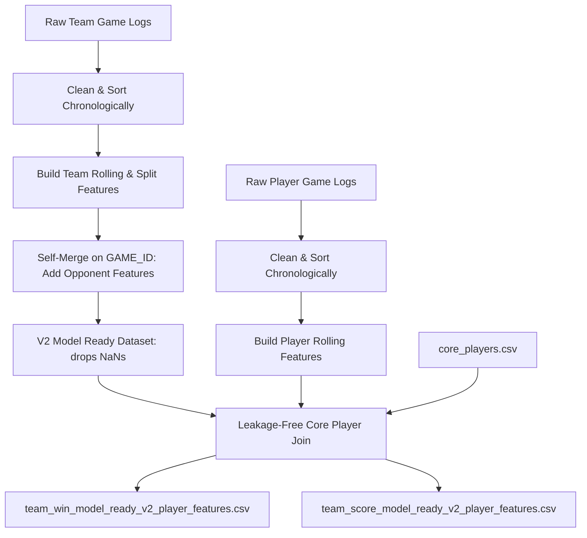

# NBA Prediction Model Current-Season Data Lineage & Processing Audit Report

> **Audit Date:** 2026-06-07
> **Season Under Audit:** 2025-26 NBA Season

---

## Executive Summary

This report provides a comprehensive lineage and audit of the NBA prediction project's current-season (2025-26) data pipelines, processing steps, feature sets, and model consumption patterns. The primary goal is to ensure a completely documented, leakage-free baseline before the ingestion of historical multi-season data. 

All audited pipelines are local and reproducible using the CLI commands implemented in [main.py](file:///Users/serhat/agProjects/nbaModelApp/main.py). Feature engineering ensures that no post-tipoff data or future game outcomes leak into training datasets or inference calls through strict chronological ordering, `shift(1)` operators on rolling averages, and date filters on inference feature queries.

---

## 1. Data Ingestion & Inventory Summary

Data ingestion has been fully migrated from Google Colab into the local project workspace.

### Data Sources
*   **NBA API (`nba_api` package):** Scrapes official NBA statistics. Core endpoints used include:
    *   `LeagueGameLog`: Pulls chronological game-by-game logs for teams and players.
    *   `BoxScoreTraditionalV2`: Pulls detailed box scores for individual completed matchups.
    *   `ScheduleLeagueV2`: Pulls the complete regular season and playoff schedule.
    *   `ScoreboardV3`: Refreshes live scores and upcoming matchup details.
*   **Manual/Fallback Lists:**
    *   `data/raw/schedule/nba_finals_upcoming_2025_26.csv`: Formats manually corrected fallback schedule details for upcoming Finals games.
    *   `data/production/core_players.csv`: A static roster of the 5 discovered "core players" per team for the 2025-26 season.

### Inventory Highlights
*   **Raw Data:** Stored in CSV formats under `data/raw/` (e.g. `nba_team_games_2025_26_regular_and_playoffs.csv`).
*   **Engineered Features:** Stored in CSV/Parquet formats under `data/features/` (e.g. `team_games_features_2025_26.csv`).
*   **Model Datasets:** Merged team-opponent and player-feature datasets stored under `data/processed/` and duplicated to `data/production/` or `data/experimental/`.
*   **Saved Weights:** Deployed pickle models stored under `models/production/` and `models/experimental/`.

---

## 2. Processing Pipeline Audit

The current pipeline moves chronologically from raw scraper dumps to engineered features, splits, merges, and finally model-ready files.

### Step 1: Clean and Sort
*   **Responsible Module:** [cleaning.py](file:///Users/serhat/agProjects/nbaModelApp/src/processing/cleaning.py)
*   **Inputs:** `data/raw/team_games/nba_team_games_2025_26_regular_and_playoffs.csv`, `data/raw/player_games/nba_player_games_2025_26_regular_and_playoffs.csv`
*   **Logic:** Standardizes dates to datetime types, cleans player minutes (converting `MM:SS` to float), and sorts the data strictly by `TEAM_ID` (or `Player_ID`) and `GAME_DATE`.
*   **Outputs:** Chronologically sorted in-memory clean dataframes.

### Step 2: Team Feature Engineering
*   **Responsible Module:** [team_features.py](file:///Users/serhat/agProjects/nbaModelApp/src/features/team_features.py)
*   **Inputs:** Clean team logs.
*   **Logic:**
    *   **Home indicator:** `IS_HOME` derived from `"vs."` in `MATCHUP`.
    *   **Rest days & Back-to-Back:** `DAYS_REST` = difference between consecutive games; `IS_B2B` = `DAYS_REST == 1`.
    *   **Rolling Offense:** `PTS_LAST_5`, `PTS_LAST_10` using `.shift(1).rolling(W).mean()`.
    *   **Rolling Win Rate:** `WINRATE_LAST_5`, `WINRATE_LAST_10` using `.shift(1).rolling(W).mean()`.
    *   **Rolling Defense:** `PTS_ALLOWED_LAST_5`, `PTS_ALLOWED_LAST_10` computed by mapping opponent score from the same `GAME_ID`, shifted by 1.
    *   **Home/Away Splits:** Separate rolling stats computed on home/away masks, shifted by 1, and then chronologically forward-filled.
    *   **Head-to-Head (H2H):** Rolling counts, win rates, and averages over historical matchups between the same team pair, shifted by 1.
*   **Outputs:** `data/features/team_games_features_2025_26.csv` and `.parquet`.

### Step 3: Player Feature Engineering
*   **Responsible Module:** [player_features.py](file:///Users/serhat/agProjects/nbaModelApp/src/features/player_features.py)
*   **Inputs:** Clean player logs.
*   **Logic:** Computes rolling averages for individual player metrics (`PTS_LAST_5`/`10`, `MIN_LAST_5`, `REB_LAST_5`, `AST_LAST_5`, `PLUS_MINUS_LAST_5`), shifted by 1 game.
*   **Outputs:** `data/features/player_games_features_2025_26.csv` and `.parquet`.

### Step 4: Opponent Self-Merge
*   **Responsible Module:** [opponent_features.py](file:///Users/serhat/agProjects/nbaModelApp/src/features/opponent_features.py)
*   **Inputs:** `team_games_features_2025_26.csv`
*   **Logic:** Merges the dataset with itself on `GAME_ID` where `TEAM_ID != TEAM_ID_opp`. Re-maps opponent columns to `OPP_` prefix.
*   **Outputs:** Intermediate opponent-aware team features dataset.

### Step 5: Core Player Join
*   **Responsible Modules:** [train_win_probability_v2.py](file:///Users/serhat/agProjects/nbaModelApp/scripts/train_win_probability_v2.py) and [build_matchup_features.py](file:///Users/serhat/agProjects/nbaModelApp/scripts/build_matchup_features.py)
*   **Inputs:** Opponent-aware team features, player features, and [core_players.csv](file:///Users/serhat/agProjects/nbaModelApp/data/production/core_players.csv).
*   **Logic:** For each matchup row on date `T`, identifies the 5 core players for both teams. 
    *   **Availability Proxy:** A player is marked "available" if they logged $>0$ minutes in any of their team's last 3 games strictly prior to date `T`.
    *   **Expected Stats:** Computes 10-game rolling averages of player minutes, points, assists, rebounds, and PRA prior to date `T`.
    *   **Aggregates:** Sums expected stats for available players, top 3 players, and missing players.
*   **Outputs:** 
    *   `data/processed/team_win_model_ready_v2_player_features.csv` (1758 rows, team-game perspective)
    *   `data/processed/team_score_model_ready_v2_player_features.csv` (879 rows, game-perspective)

### Leakage-Prevention Rules
1.  **Shift Operators:** All rolling window averages use a `shift(1)` step to ensure that the current game's stats are not included in the rolling mean.
2.  **Date Filtering:** When computing historical player/team availability for any game on date `T`, the data is strictly filtered to `GAME_DATE < T`.
3.  **No Observed Box Score Statistics:** Model datasets exclude columns indicating post-tipoff observed stats like `PLAYED_COUNT`, `MINUTES_SUM`, or `AVAILABLE_RATE`. (These are present only in the `v3` dataset marked *Exploratory Only*).

---

## 3. Model Dataset Lineage & Inventory

The project distinguishes between production-level, experimental, and archive-level files. The full inventory and lineage are cataloged in:
*   [current_season_dataset_inventory.csv](file:///Users/serhat/agProjects/nbaModelApp/reports/audits/current_season_dataset_inventory.csv)
*   [current_season_feature_catalog.csv](file:///Users/serhat/agProjects/nbaModelApp/reports/audits/current_season_feature_catalog.csv)

---

## 4. Current Inference Flow

Predictions are generated via `FastAPI` service request, command line inference scripts, or frontend dashboard loads.

1.  **User Input:** User requests a prediction for `home_team`, `away_team`, and `prediction_date` (e.g. LAL, BOS, 2026-03-15).
2.  **Feature Construction:**
    *   [build_matchup_features.py](file:///Users/serhat/agProjects/nbaModelApp/scripts/build_matchup_features.py) reads `data/features/team_games_features_2025_26.parquet` and raw player/team games.
    *   Applies a query filter: `GAME_DATE < prediction_date` to prevent future data leakage.
    *   Retrieves the last available game row for each team and computes H2H history, days of rest, and player availability.
    *   Constructs a dictionary of features in the exact order specified in [feature_columns.json](file:///Users/serhat/agProjects/nbaModelApp/models/production/feature_columns.json).
3.  **Production Artifact Resolution:**
    *   [artifact_paths.py](file:///Users/serhat/agProjects/nbaModelApp/scripts/artifact_paths.py) reads [production_artifacts.yaml](file:///Users/serhat/agProjects/nbaModelApp/config/production_artifacts.yaml) to load the production model files.
    *   Loads `models/production/win_probability_model.pkl` (calibrated Logistic Regression) and `models/production/home_score_model_v2.pkl` / `away_score_model_v2.pkl` (Random Forests).
4.  **Prediction Output:**
    *   **Win Probability:** Returns predicted winner, probabilities, and a confidence bucket.
    *   **Score Model:** Predicts home and away scores, calculates derived total and margin, applies the 80% empirical prediction intervals, and returns the output.

---

## 5. Pipeline Gaps and Risks

Detailed in [current_season_pipeline_gaps.md](file:///Users/serhat/agProjects/nbaModelApp/reports/audits/current_season_pipeline_gaps.md), the primary architectural issues are:
1.  **Hardcoded Season Paths:** File paths in feature building and model scripts are hardcoded with the `2025_26` season name.
2.  **Lack of Historical Roster snapshoting:** The system currently relies on a static [core_players.csv](file:///Users/serhat/agProjects/nbaModelApp/data/production/core_players.csv), which is invalid for historical seasons since player rosters shift and players are traded mid-season.
3.  **Absence of Automated Tests:** There are no unit tests checking feature calculations or confirming lack of leakage in rolling averages.

---

## 6. Recommendations & Final Verdict

1.  **Is the current 2025-26 pipeline reproducible locally?**
    *   **Yes.** The pipeline runs locally via `python main.py --update-data` and `--build-enhanced-v2`, generating identical results.
2.  **Which missing scripts must be added before historical ingestion?**
    *   A parameter-driven multi-season data downloader/updater script.
    *   A roster snapshot generator that processes a transactions table to build historical rosters for any point in time.
3.  **Can the current feature logic be reused for past seasons?**
    *   Yes, the rolling window equations, home/away splits, H2H, and opponent merges are season-agnostic and can be applied directly once paths are parameterized.
4.  **What must change before collecting 5+ seasons?**
    *   Refactor all paths under `data/` and `models/` to be parameterized by season ID.
    *   Build a proper multi-season database (SQLite or partitioned parquet files) rather than flat CSV files.
    *   Set up a chronological season-based cross-validation pipeline.
5.  **What is the safest next step?**
    *   Parameterize [build_matchup_features.py](file:///Users/serhat/agProjects/nbaModelApp/scripts/build_matchup_features.py) and feature modules to accept a `--season` argument.
