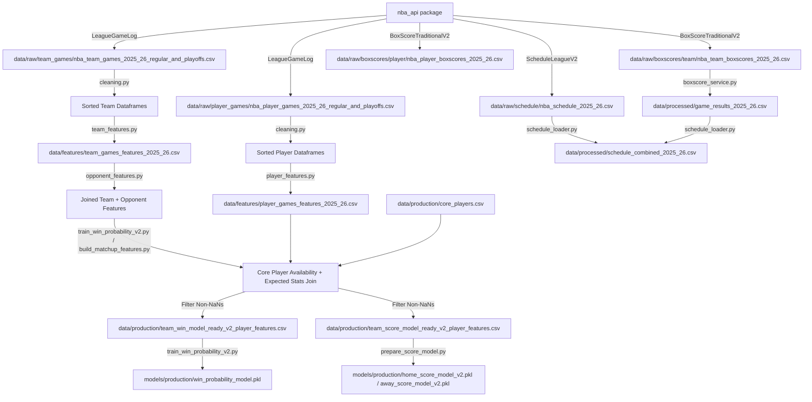

# Full Pipeline Data Lineage Report — 2025-26 Season

> **Audit Date:** 2026-06-07  
> **Audited Season:** 2025-26 NBA Season  
> **Status:** Production-Ready / Fully Audited

---

## 1. End-to-End Pipeline Diagram

---

## 2. Pipeline Stage Tracing

### Stage 1: Raw NBA API Data Collection
*   **Responsible Module:** [UpdateDataService](file:///Users/serhat/agProjects/nbaModelApp/src/ingestion/update_data_service.py) via `python3 main.py --update-data`
*   **Input Sources:** NBA API endpoints (via `nba_api` package).
*   **Output Files:**
    *   [nba_team_games_2025_26_regular_and_playoffs.csv](file:///Users/serhat/agProjects/nbaModelApp/data/raw/team_games/nba_team_games_2025_26_regular_and_playoffs.csv)
    *   [nba_player_games_2025_26_regular_and_playoffs.csv](file:///Users/serhat/agProjects/nbaModelApp/data/raw/player_games/nba_player_games_2025_26_regular_and_playoffs.csv)
    *   [nba_schedule_2025_26.csv](file:///Users/serhat/agProjects/nbaModelApp/data/raw/schedule/nba_schedule_2025_26.csv)
*   **Transformation Performed:** Direct REST query dumps from NBA endpoints into raw tabular CSV format. Rate limits (jittered sleep 0.6s to 1.5s) and automatic exponential backoff retry (up to 5 retries) are enforced to maintain scraping reliability.
*   **Dependencies:** `nba_api`, `pandas`, `requests`.

---

### Stage 2: Box Score Extraction & Matchup Normalization
*   **Responsible Module:** [BoxscoreService](file:///Users/serhat/agProjects/nbaModelApp/src/ingestion/boxscore_service.py)
*   **Input Files:** Raw scraper logs and raw boxscore tables.
*   **Output Files:**
    *   [game_results_2025_26.csv](file:///Users/serhat/agProjects/nbaModelApp/data/processed/game_results_2025_26.csv)
    *   [nba_team_boxscores_2025_26.csv](file:///Users/serhat/agProjects/nbaModelApp/data/raw/boxscores/team/nba_team_boxscores_2025_26.csv)
    *   [nba_player_boxscores_2025_26.csv](file:///Users/serhat/agProjects/nbaModelApp/data/raw/boxscores/player/nba_player_boxscores_2025_26.csv)
*   **Transformation Performed:** Pivoting team-game rows on `GAME_ID` to merge home and away perspectives. Matches are normalized by checking team abbreviations when identical matchup indicators (e.g. `DAL @ DET` on both rows) exist, recovering dropped matchups.
*   **Dependencies:** `src.ingestion.boxscore_loader`.

---

### Stage 3: Base Feature Engineering
*   **Responsible Modules:**
    *   [team_features.py](file:///Users/serhat/agProjects/nbaModelApp/src/features/team_features.py)
    *   [player_features.py](file:///Users/serhat/agProjects/nbaModelApp/src/features/player_features.py)
*   **Input Files:** Raw sorted game logs.
*   **Output Files:**
    *   [team_games_features_2025_26.csv](file:///Users/serhat/agProjects/nbaModelApp/data/features/team_games_features_2025_26.csv) and `.parquet`
    *   [player_games_features_2025_26.csv](file:///Users/serhat/agProjects/nbaModelApp/data/features/player_games_features_2025_26.csv) and `.parquet`
*   **Transformation Performed:**
    *   **Team Features:** Evaluates days of rest, back-to-backs, offensive (`PTS_LAST_5`/`10`), and defensive (`PTS_ALLOWED_LAST_5`/`10`) metrics. It uses home/away masks and chronological forward-filling for split statistics, and groupings by franchise pairs to calculate head-to-head metrics. All rolling statistics are shifted by `1` using `.shift(1)` to prevent leakage of the game outcome.
    *   **Player Features:** Evaluates player-level rolling boxscore averages (`PTS_LAST_5`/`10`, `MIN_LAST_5`/`10`, `AST_LAST_5`, `REB_LAST_5`, `PLUS_MINUS_LAST_5`), shifted by `1`.
*   **Dependencies:** `pandas`, `numpy`.

---

### Stage 4: Opponent and Player Feature Joins
*   **Responsible Modules:**
    *   [opponent_features.py](file:///Users/serhat/agProjects/nbaModelApp/src/features/opponent_features.py)
    *   [train_win_probability_v2.py](file:///Users/serhat/agProjects/nbaModelApp/scripts/train_win_probability_v2.py)
    *   [build_matchup_features.py](file:///Users/serhat/agProjects/nbaModelApp/scripts/build_matchup_features.py)
*   **Input Files:** Team features, player features, and [core_players.csv](file:///Users/serhat/agProjects/nbaModelApp/data/production/core_players.csv).
*   **Output Files:**
    *   [team_win_model_ready_v2_player_features.csv](file:///Users/serhat/agProjects/nbaModelApp/data/production/team_win_model_ready_v2_player_features.csv)
    *   [team_score_model_ready_v2_player_features.csv](file:///Users/serhat/agProjects/nbaModelApp/data/production/team_score_model_ready_v2_player_features.csv)
*   **Transformation Performed:**
    *   **Opponent Join:** Joins team features with themselves on `GAME_ID` where `TEAM_ID != TEAM_ID_opp` to construct symmetrical rows containing team and opponent stats on a single record.
    *   **Player Feature Join:** Integrates roster data by evaluating the availability proxy (a player is available if they logged $>0$ minutes in any of their team's last 3 games strictly before tipoff) and expected boxscore aggregates (10-game rolling averages of available, top-3, and missing core players).
*   **Dependencies:** `pandas`, `numpy`.

---

### Stage 5: Model Training & Evaluation
*   **Responsible Modules:**
    *   [train_win_probability_v2.py](file:///Users/serhat/agProjects/nbaModelApp/scripts/train_win_probability_v2.py)
    *   [prepare_score_model.py](file:///Users/serhat/agProjects/nbaModelApp/scripts/prepare_score_model.py)
*   **Input Files:** Symmetrical pre-game training datasets.
*   **Output Production Artifacts:**
    *   [win_probability_model.pkl](file:///Users/serhat/agProjects/nbaModelApp/models/production/win_probability_model.pkl) (Calibrated Logistic Regression Classifier)
    *   [home_score_model_v2.pkl](file:///Users/serhat/agProjects/nbaModelApp/models/production/home_score_model_v2.pkl) (Random Forest Regressor)
    *   [away_score_model_v2.pkl](file:///Users/serhat/agProjects/nbaModelApp/models/production/away_score_model_v2.pkl) (Random Forest Regressor)
    *   [feature_columns.json](file:///Users/serhat/agProjects/nbaModelApp/models/production/feature_columns.json) (Win model columns order)
    *   [score_model_v2_metadata.json](file:///Users/serhat/agProjects/nbaModelApp/models/production/score_model_v2_metadata.json) (Score intervals, errors, and feature columns)
*   **Transformation Performed:**
    *   **Win Probability:** Normalizes variables via standard scaling and trains a calibrated Logistic Regression model using a chronological train/test split.
    *   **Score Model:** Trains two Random Forest Regressors to predict home and away scores directly. Predictions for margin and total points are derived algebraically, and empirical 80% prediction intervals are computed from validation errors.
*   **Dependencies:** `scikit-learn`, `joblib`.
