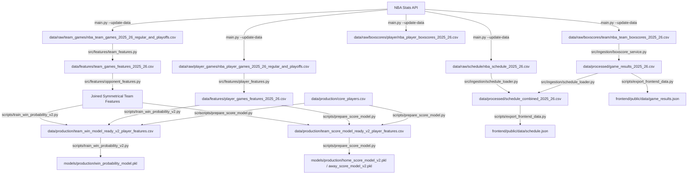

# Pipeline Dependency Graph

This document visualizes the dataset and script dependency chains of the NBA prediction project.

---

## 1. Dependency Graph (Mermaid Flowchart)

---

## 2. Dependency Chains

### 2.1 Win Probability Model V2 Chain
1.  `nba_api` ➡️ [main.py --update-data](file:///Users/serhat/agProjects/nbaModelApp/main.py)
2.  ➡️ [nba_team_games_2025_26_regular_and_playoffs.csv](file:///Users/serhat/agProjects/nbaModelApp/data/raw/team_games/nba_team_games_2025_26_regular_and_playoffs.csv)
3.  ➡️ [team_features.py](file:///Users/serhat/agProjects/nbaModelApp/src/features/team_features.py)
4.  ➡️ [team_games_features_2025_26.csv](file:///Users/serhat/agProjects/nbaModelApp/data/features/team_games_features_2025_26.csv)
5.  ➡️ [opponent_features.py](file:///Users/serhat/agProjects/nbaModelApp/src/features/opponent_features.py)
6.  ➡️ Joined Symmetrical Team Features
7.  ➡️ [train_win_probability_v2.py](file:///Users/serhat/agProjects/nbaModelApp/scripts/train_win_probability_v2.py) (combining [player_games_features_2025_26.csv](file:///Users/serhat/agProjects/nbaModelApp/data/features/player_games_features_2025_26.csv) and [core_players.csv](file:///Users/serhat/agProjects/nbaModelApp/data/production/core_players.csv))
8.  ➡️ [team_win_model_ready_v2_player_features.csv](file:///Users/serhat/agProjects/nbaModelApp/data/production/team_win_model_ready_v2_player_features.csv)
9.  ➡️ [train_win_probability_v2.py](file:///Users/serhat/agProjects/nbaModelApp/scripts/train_win_probability_v2.py)
10. ➡️ [win_probability_model.pkl](file:///Users/serhat/agProjects/nbaModelApp/models/production/win_probability_model.pkl)

### 2.2 Score Prediction Model V2 Chain
1.  `nba_api` ➡️ [main.py --update-data](file:///Users/serhat/agProjects/nbaModelApp/main.py)
2.  ➡️ [nba_player_games_2025_26_regular_and_playoffs.csv](file:///Users/serhat/agProjects/nbaModelApp/data/raw/player_games/nba_player_games_2025_26_regular_and_playoffs.csv)
3.  ➡️ [player_features.py](file:///Users/serhat/agProjects/nbaModelApp/src/features/player_features.py)
4.  ➡️ [player_games_features_2025_26.csv](file:///Users/serhat/agProjects/nbaModelApp/data/features/player_games_features_2025_26.csv)
5.  ➡️ [prepare_score_model.py](file:///Users/serhat/agProjects/nbaModelApp/scripts/prepare_score_model.py) (combining Opponent-aware Team Features and Roster data)
6.  ➡️ [team_score_model_ready_v2_player_features.csv](file:///Users/serhat/agProjects/nbaModelApp/data/production/team_score_model_ready_v2_player_features.csv)
7.  ➡️ [prepare_score_model.py](file:///Users/serhat/agProjects/nbaModelApp/scripts/prepare_score_model.py)
8.  ➡️ [home_score_model_v2.pkl](file:///Users/serhat/agProjects/nbaModelApp/models/production/home_score_model_v2.pkl) and [away_score_model_v2.pkl](file:///Users/serhat/agProjects/nbaModelApp/models/production/away_score_model_v2.pkl)
