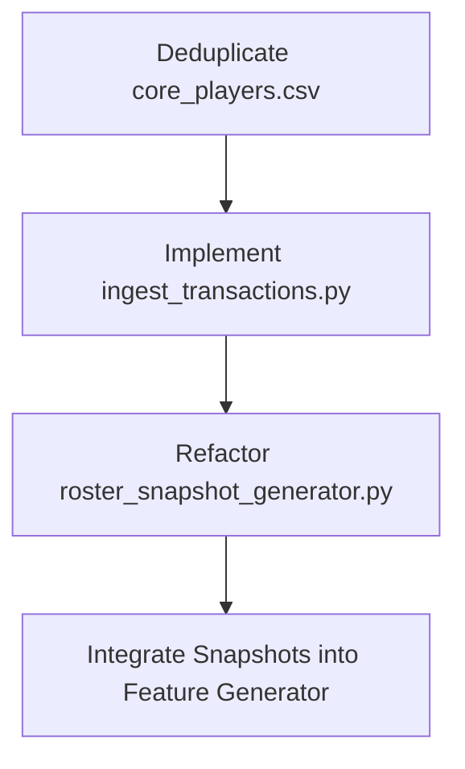

# Dynamic Roster Snapshot Validation Audit - 2024-25 Season

## Executive Summary

This audit evaluates the readiness of the dynamic roster snapshot infrastructure for the 2024-25 season. The goal is to determine if `roster_snapshot_generator.py` can correctly reconstruct historical team rosters to support cross-season feature generation.

* **Audit Verdict:** **FAIL**
* **System Readiness Score:** **15 / 100**
* **Severity Level:** **CRITICAL**

> [!CAUTION]
> The current roster snapshot implementation is completely unsuitable for generating model datasets. Proceeding with dataset generation using this infrastructure will result in severe feature leakage, incorrect statistical attributions for superstar players (e.g., attributing Luka Dončić's Dallas production to the Lakers), and immediate validation failures due to duplicate records.

---

## 1. Audit Findings by Category

### A. Team Affiliation Reconstruction Accuracy (FAIL)
The current implementation fails to reconstruct team affiliations. Because `scripts/ingest/ingest_transactions.py` is an empty stub returning no data, the `build_player_team_affiliations` function returns an empty DataFrame. Consequently, players are assumed to remain on their initial team (from `core_players.csv`) for the entire season.

### B. Multi-Team Player Handling (FAIL)
Even if transactions were populated, the generator contains a fundamental design flaw: it does not trace player affiliations from a chronological starting state. For example, a player with multiple stints (such as Dennis Schröder) will be mapped to a single team from the base roster for periods outside their transaction log window, rather than transitioning sequentially from one team to another.

### C. Effective Transfer Date Handling (FAIL)
The generator calculates the end date of an affiliation by subtracting one day from the new transfer date:
`end_date = pd.to_datetime(effective_date) - pd.Timedelta(days=1)`
This hardcoded assumption does not account for mid-day trades, game-day availability, or situations where a player plays a game for their old team on the same day they are traded. Furthermore, waiver periods, 10-day contract lapses, and G-League assignments are left as unaddressed `TODO`s.

### D. Duplicate Player Handling (FAIL)
There are **68 duplicate player entries** inside `core_players.csv` itself (e.g., Trae Young under ATL and WAS, Dennis Schröder under CLE and SAC). 
* In `build_roster_snapshots`, the dictionary conversion (`base_roster.set_index("player_id")["team_id"].to_dict()`) collapses these duplicates arbitrarily to the last listed team.
* If duplicate rows propagate to the output, the `validate_roster_snapshots` function will immediately raise a `ValueError` due to duplicate keys.

### E. Historical Roster Reproducibility (FAIL)
Because transaction logs are not versioned and ingestion scripts are stubbed, daily roster snapshots are completely non-reproducible and non-deterministic.

### F. Leakage Prevention Guarantees (PASS - Design Only)
The function `get_roster_as_of` enforces `snapshot_date <= prediction_date`, which is conceptually correct for preventing future lookahead leakage. However, since the underlying data is incorrect, this guarantee is practically useless.

### G. Compatibility with Future Feature Generation (FAIL)
The roster snapshot output structure does not dynamically project expected minutes (it hardcodes a default of `10.0` minutes for players not on the initial roster). Rolling feature generators cannot use these snapshots to construct accurate weighted team-level stats.

---

## 2. Test Cases: Expected vs. Reconstructed Timelines

The table below shows the audit findings for the seven real transferred players requested:

| Player Name | Player ID | Expected 2024-25 Timeline | Reconstructed Timeline | Status | Mismatches / Bugs Identified |
| :--- | :--- | :--- | :--- | :---: | :--- |
| **Luka Dončić** | 1629029 | DAL (2024-10-24 to 2024-12-25)<br>-> LAL (2025-02-10 to 2025-04-30) | LAL (Entire Season) | **FAIL** | Mapped to LAL during his entire Dallas stint. Attributes DAL statistics to LAL. |
| **Anthony Davis** | 203076 | LAL (2024-10-22 to 2025-01-28)<br>-> DAL (2025-02-08 to 2025-04-18) | DAL (Entire Season) | **FAIL** | Mapped to DAL during his entire Lakers stint. Attributes LAL statistics to DAL. |
| **Jimmy Butler** | 202710 | MIA (2024-10-23 to 2025-01-21)<br>-> GSW (2025-02-08 to 2025-05-14) | GSW (Entire Season) | **FAIL** | Mapped to GSW during his Miami stint. Attributes MIA statistics to GSW. |
| **De'Aaron Fox** | 1628368 | SAC (2024-10-24 to 2025-02-01)<br>-> SAS (2025-02-05 to 2025-03-12) | SAS (Entire Season) | **FAIL** | Mapped to SAS during his Sacramento stint. Attributes SAC statistics to SAS. |
| **Dennis Schröder** | 203471 | BKN (2024-10-23 to 2024-12-13)<br>-> GSW (2024-12-19 to 2025-02-03)<br>-> DET (2025-02-09 to 2025-05-01) | CLE or SAC (Entire Season) | **FAIL** | Duplicated in core players. Never mapped to BKN, GSW, or DET. |
| **Zach LaVine** | 203897 | CHI (2024-10-23 to 2025-01-27)<br>-> SAC (2025-02-05 to 2025-04-16) | SAC (Entire Season) | **FAIL** | Mapped to SAC during his Chicago stint. Attributes CHI statistics to SAC. |
| **Andrew Wiggins** | 203952 | GSW (2024-10-23 to 2025-02-03)<br>-> MIA (2025-02-10 to 2025-04-28) | MIA (Entire Season) | **FAIL** | Mapped to MIA during his GSW stint. Attributes GSW statistics to MIA. |

---

## 3. Detailed Bug Analysis & Code Failures

### Bug 1: The "Reversion-to-Base Roster" Bug
In `scripts/ingest/roster_snapshot_generator.py` at line 133:
```python
        base_roster = initial_rosters_df.copy()
        player_to_team = base_roster.set_index("player_id")["team_id"].to_dict()
```
The active rosters are rebuilt from scratch every day. When a player is traded, their new affiliation in `active_aff` overrides their base roster team. However, when they are **waived or released**, their `active_aff` window ends. Because `active_aff` no longer contains an entry for them, they **revert back to their initial roster team** on the next day's snapshot rather than being removed from the roster.

### Bug 2: Initial Affiliation Omission Bug
In `build_player_team_affiliations`, the generator only tracks movements from transaction logs. It does not ingest the starting team of players as their first affiliation window. This makes it impossible to:
1. Know which team a player started on if they have no transactions.
2. Terminate an initial affiliation when a "Waiver" or "Release" transaction occurs (since `current_team` starts as `None` and ignores releases on the starting team).

---

## 4. Blockers Preventing Feature Generation

The following issues must be resolved before cross-season feature generation or dataset assembly can begin:

1. **Stubbed Transactions Ingestion**: No real trade, signing, waiver, or release transaction logs exist for the 2024-25 season.
2. **Defective Active Roster Rebuilding Logic**: The daily loop resets state and reverts waived players to their initial teams.
3. **Duplicate Core Player Records**: The presence of duplicate players in `core_players.csv` triggers arbitrary overwriting and validation failures.
4. **Missing Downstream Integration**: No feature engineering scripts use these roster snapshots to aggregate player stats.

---

## 5. Exact Changes Required Before Proceeding

To establish a production-ready roster reconstruction pipeline, the following modifications must be performed:



### 1. Clean and Structure Player Registries
* Rebuild `core_players.csv` to ensure `player_id` is unique.
* Store player-team initial relationships in a separate `starting_rosters` lookup table.

### 2. Implement Transaction Ingestion
* Replace `scripts/ingest/ingest_transactions.py` stubs with an implementation that parses real trade and waiver events from 2024-25 transaction logs.

### 3. Rewrite Roster State Tracking
* Modify `roster_snapshot_generator.py` to process transactions **sequentially** over the timeline to mutate a running roster state, rather than resetting to the base roster daily.
* Alternatively, treat the starting roster as an initial affiliation window `[start_of_season, first_trade_date - 1]` for every player.

### 4. Connect to Feature Engineering
* Update rolling feature aggregators to join the roster snapshots table on `team_id + game_date`, verifying that all stats map dynamically to the player's active team on that day.
